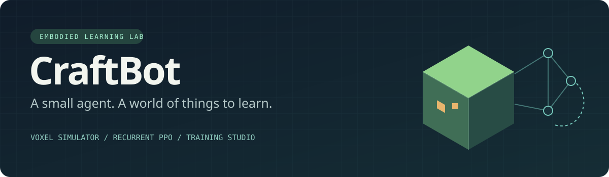
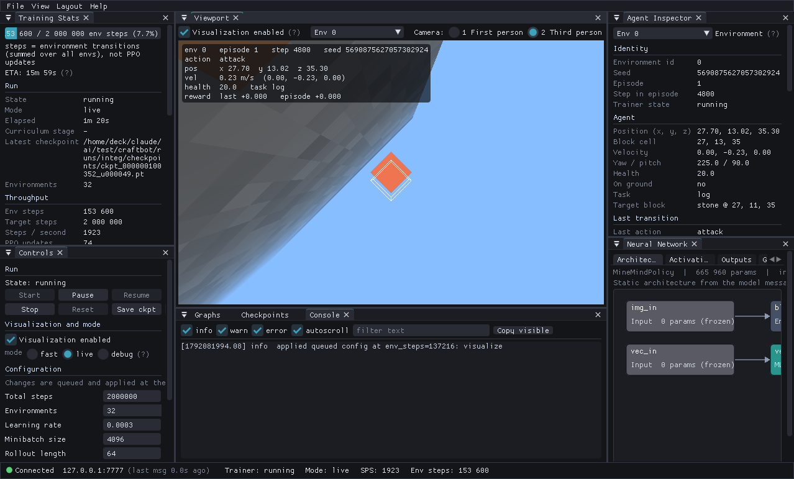

<p align="center"></p>

<p align="center">
  <strong>See a world. Choose an action. Learn what happens.</strong><br>
  A custom voxel simulator, recurrent learning agent and live training studio.
</p>

<p align="center">
  <a href="docs/quickstart.md">Quickstart</a> ·
  <a href="docs/training.md">Train your agent</a> ·
  <a href="docs/models.md">Selected models</a> ·
  <a href="docs/minecraft.md">Minecraft bridge</a> ·
  <a href="docs/architecture.md">How it works</a>
</p>

---

CraftBot explores how much a compact recurrent policy can learn in a procedural,
Minecraft-like environment. It combines a **C++20 CPU simulator**, a **PyTorch
CNN + GRU policy**, **PPO**, scripted demonstrations and an optional **SDL3/ImGui
dashboard**. The normal training path needs no GPU and no running Minecraft game.

The policies are defined and trained here; they are not calls to a hosted LLM.
The small v7 model has **1,891,287 parameters**. Established learning algorithms
and libraries power the system; this is an experimental learning lab, with
measured strengths and substantial unsolved tasks.

## What is here?

| Piece | What you can do |
| --- | --- |
| Voxel simulator | Run parallel worlds, mine, craft, explore, build and interact with teammates |
| Recurrent policy | Combine block/depth images, inventory/task observations and temporal memory |
| Training | Start PPO from initialization, resume a checkpoint or add expert demonstration losses |
| Studio | Inspect the world, learning curves, actions, activations and checkpoints live |
| Model collection | Use selected v6 goal and v7 multitask checkpoints, with documented evaluations |
| Fabric bridge | Serve a compatible v6 policy to bots in Minecraft Java 26.2 |

## Start here

On Steam Deck, the helper enters **`distrobox enter hi`** for Python and builds.
Install the native prerequisites in `hi` first; see the [complete quickstart](docs/quickstart.md).

```bash
git clone https://github.com/5ovfivex5-bit/craftbot.git
cd craftbot

./scripts/craftbot.sh setup
./scripts/craftbot.sh build
./scripts/craftbot.sh download-models

# Run a selected policy on fresh worlds. This evaluates; it does not train.
./scripts/craftbot.sh eval models/best-v7.pt --obs v7 \
  --task gather_wood --episodes 16 --envs 8 --agents 4 --policy all
```

Already have this local workspace? Start with `setup` and `build`; the model
exporter can package your retained training runs instead of downloading them.

## Train a first agent

```bash
./scripts/craftbot.sh train --obs v7 --no-server \
  --envs 8 --agents 1 --threads 2 --workers 2 \
  --total-steps 100000 --seed 42 --run-id first-agent
```

This is a small pipeline run. A useful agent usually requires longer training,
evaluation and curriculum tuning. Checkpoints and logs appear under
`runs/first-agent/`. **Ctrl+C finishes the active update and saves.**

Want more? The [training tutorial](docs/training.md) covers demonstrations,
behavior cloning, continued training and the difference between v6 and v7.

## Which model should I use?

| Model | Use it for | Best-supported historical result |
| --- | --- | --- |
| `best-v6.pt` | Legacy goal-based crafting and the Minecraft bridge | 100% wooden pickaxe, 95.3% stone pickaxe, 100% furnace, 18.8% coal |
| `best-v7.pt` | Current multitask simulator and further v7 experiments | 62.5% wood, 56.2% sand, 81.2% crafting table, 12.5% wooden pickaxe |

These are **different protocols**, not directly comparable model scores. The
v6 figures use 64 episodes per goal; v7 uses 16 per task, both with sampled
actions and four-agent populations. “Best” means recommended from the saved
comparisons, not a universal winner across every task or every local checkpoint.
Several v7 tasks still score zero. See the [model cards and full results](docs/models.md).

Weights are distributed as GitHub Release assets, verified by SHA-256, rather
than filling the source history with experiment checkpoints.

## Watch training in Studio

Start a live trainer instead of `--no-server`, then open the dashboard in another
terminal. [Build and connection instructions →](docs/quickstart.md#optional-training-studio)



*An actual screenshot from an earlier training run. Model dimensions and UI
details can differ from the current v7 build.*

## Project map

```text
src/          Native simulator and Python bindings
craftsim.py   Python simulator interface
trainer/      Policy, PPO, task curriculum, cloning and telemetry
tasklib/      Task schemas, sampling and prerequisite graph
experts/      Scripted demonstrations through ordinary simulator actions
data/         Registry, task, blueprint and environment-mix definitions
dashboard/    Optional C++ training studio
mcmod/        Fabric bot integration
mcrecorder/   Optional human-play recorder
mcbridge/     Local policy server and online fine-tuning code
gpusim/       Experimental GPU backend; not the current v6/v7 trainer path
docs/         Tutorials, architecture, model cards and evaluation evidence
models/       Download/export destination for selected release checkpoints
```

## Checks and current limits

```bash
./scripts/craftbot.sh test
./scripts/craftbot.sh test --full
```

The first command validates registry/task data and runs simulator tests. The
second adds subsystem, expert and behavior-cloning checks. Some legacy tests
include throughput thresholds, so inspect failures on slower hardware.

- v6 has a 102-element observation and legacy actions; v7 has 295 elements and
  primary/recipe/item/message heads. Use the matching `--obs` flag.
- The Fabric bridge supports v6/v5, not v7. Simulator success does not establish
  the same success rate in the real game.
- The trainer currently rejects the experimental GPU simulator backend for
  these layouts. The 100M architecture is not the recommended released model.
- [PROTOCOL.md](PROTOCOL.md) and [historical notes](docs/reference/trainer-history.md)
  include earlier designs; runnable tutorials describe the current entry points.

## License and acknowledgements

Project code and curated checkpoints: [MIT](LICENSE). Dependencies retain their
own licences; see [THIRD_PARTY.md](THIRD_PARTY.md). Minecraft is a separate game
owned by Mojang/Microsoft; no game binaries, worlds or decompiled sources are
included. This project is not affiliated with or endorsed by them.
