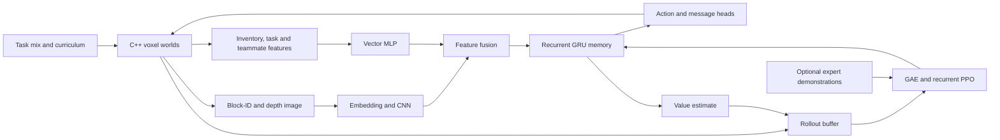

# How CraftBot works

## The learning loop

The image is a semantic block-ID plus depth rendering, not a full RGB Minecraft
screenshot. The structured vector carries information such as inventory,
health, goal/task and teammate state. This gives the policy a deliberately
simplified observation space.

## Native simulator

`src/` implements the procedural world, physics/interactions, crafting, mobs,
survival, Nether and building components. pybind11 exposes batched operations
through `_craftsim`; `craftsim.py` provides the Python interface. Registry,
recipe, task and blueprint JSON files generate native headers before building.

`num_envs` counts worlds. Each world contains K agents; per-agent arrays have
`num_envs × K` rows. World-level save/load and task assignment use world indices.
This distinction matters in observation handling and episode accounting.

## Recurrent agent

`trainer/model.py` defines the policy. The small model uses a block embedding,
CNN, vector MLP, fused features and a GRU. Each agent carries its own hidden
state, reset at episode boundaries. Policy and value heads support recurrent PPO.

v7 adds a primary-action head plus recipe, item-selection and message heads.
Inactive conditional heads contribute neutral actions. Inventory-dependent
masks constrain recipe/item sampling and must be reproduced when calculating
PPO action likelihoods. Model heads and vector dimensions are part of the
checkpoint's observation signature.

## Training and task progression

`trainer/run.py` orchestrates collection, PPO updates, checkpointing and command
handling. `tasklib/` and `trainer/tasks.py` maintain task prerequisites,
success estimates, unlocks and world-family assignment. v6 retains the older
goal-item curriculum. Optional per-agent populations use evolution/mutation
logic and keep multiple parameter sets in one checkpoint.

`experts/` generates demonstrations using normal actions but privileged
state for planning. `trainer/bc_v7.py` learns from those traces before PPO;
the PPO trainer can also use demonstration losses during online learning.
`pretrain/` and `mcrecorder/` support the separate human-recording workflow.

## Studio and integration

Studio is a separate SDL3/OpenGL/ImGui process. It subscribes to the trainer's
JSON-lines telemetry on localhost, renders world snapshots and sends control
commands. Expensive visual instrumentation is decoupled from normal headless
training.

The Fabric mod talks to `mcbridge/bridge.py` on localhost:7788. That bridge
supports legacy v5/v6 checkpoints and maintains per-bot recurrent state. Its
presence does not imply v7 support or perfect simulator/game parity.

## Implemented paths versus research notes

The normal v6/v7 pipeline is CPU-only. `gpusim/` contains an experimental CUDA
simulation path; the current main trainer explicitly refuses it for these
layouts. A larger policy option exists in source, but the selected models are
the small policies documented in the model cards. Historical research notes,
architecture comparisons and protocol proposals remain available without
being presented as completed capabilities.
